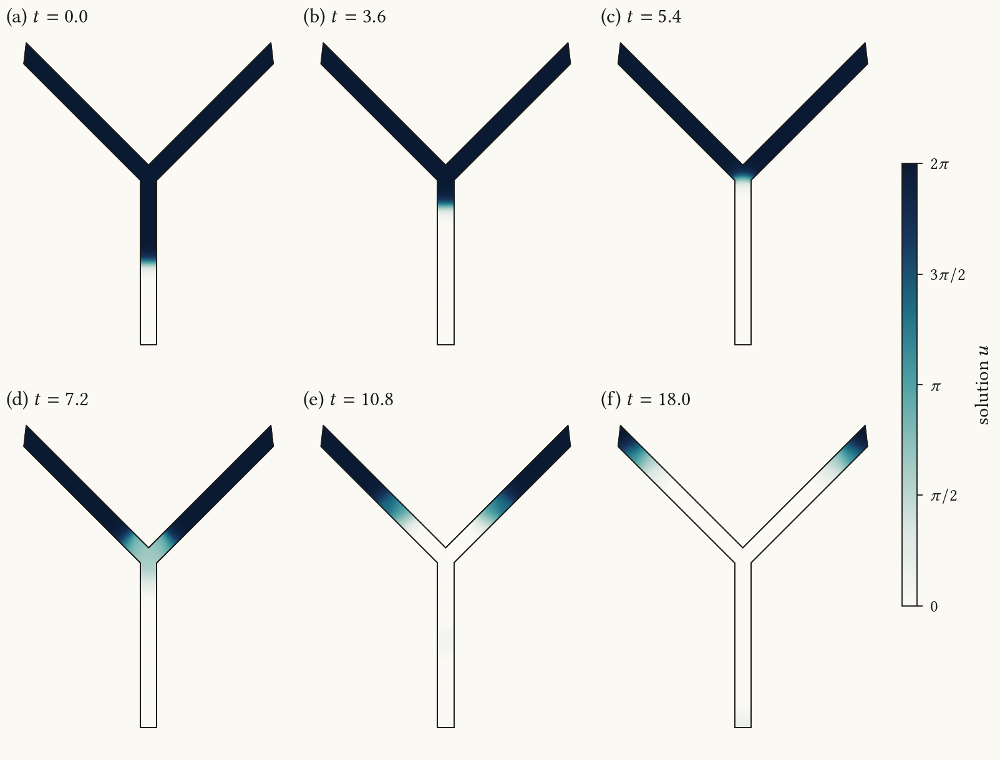

<!-- Author: Dr. Denys Dutykh (Mathematics Department, Khalifa University of Science and Technology, Abu Dhabi, UAE) -->

# sineGordon_FreeFem: a sine-Gordon kink crossing a Y junction, by finite elements in FreeFem++



The run of `script/sG_solver.edp` as shipped, at t = 0, 3.6, 5.4, 7.2, 10.8 and 18, on one colour scale for all panels,
from u = 0 (white) to u = 2π (navy). The kink of speed 0.96 starts in the middle of the lower branch (a) and runs up
towards the fork (b); it reaches the fork (c) and, carrying more energy than two kinks at rest in the upper branches,
crosses it and splits into two kinks, one in each upper branch (d), which travel towards the ends of the branches (e, f).
About 5 % of the energy stays behind in the lower branch.

The FreeFem++ script of this repository solves the two-dimensional sine-Gordon equation in a Y junction, a domain made
of three branches of width 1 and length 10 meeting at a fork, with a homogeneous Neumann condition on its whole boundary,
by quadratic (P2) Lagrange finite elements on an unstructured triangular mesh and a three-level scheme in time, implicit
in the Laplacian and explicit in the sine, which keeps the energy. It computes the passage of a kink through the
junction. Such two-dimensional computations are the reference of the article by Jean-Guy Caputo and Denys Dutykh in
Physical Review E (2014), cited below, which compares them with a one-dimensional effective model of the junction.

## The problem

In the Y junction Ω, the solution u(x, y, t) obeys

```text
∂²u/∂t² − Δu + sin u = 0        in Ω, for t ⩾ 0,
∂u/∂n = 0                        on the boundary of Ω,
```

and its energy

```text
E = ∫ ( ½ (∂u/∂t)² + ½ |∇u|² + 1 − cos u ) dx dy        (integral over Ω)
```

is conserved. The lower branch is the strip −0.5 ⩽ x ⩽ 0.5, −10 ⩽ y ⩽ 0 (length `L = 10`, width `w0 = 1`), and the two
upper branches, of length 10 and width `w1 = 1`, leave the fork at 45° on either side of the vertical (`th = 45`). At
t = 0 and t = Δt the solution is the kink

```text
u(x, y, t) = 4 arctan exp(γ (y − y₀ − c t)),        γ = 1/√(1 − c²),        c = 0.96,    y₀ = −5,
```

homogeneous across the lower branch and moving towards the fork, with the energy 8γ ≈ 28.57 for the width 1. With the
scalar product (f, g) of L²(Ω) and the test functions ψ of the P2 space, each step solves

```text
(u(n+1) − 2 u(n) + u(n−1), ψ) + ½ Δt² (∇(u(n+1) + u(n−1)), ∇ψ) + Δt² (sin u(n), ψ) = 0
```

for u(n+1) ≈ u(·, (n+1)Δt), where the Laplacian is the mean of the levels n + 1 and n − 1 and the sine is taken at the
level n; the Neumann condition is the natural condition of this weak form, and every step solves a linear system with
the same matrix by conjugate gradients. The boundary is cut into segments of length about 0.04, which gives 19 737
vertices and 37 897 triangles (elements of size 0.032 to 0.073), and the time step is Δt = 18/3500 ≈ 0.00514, with 3500
steps up to t = 18.

## Quick start

The script writes its results in the folder where it is run, so it is best run from a folder of its own:

```sh
mkdir results && cd results
FreeFem++ ../script/sG_solver.edp
```

It prints the sizes of the elements and the time step, then the time and the total energy every 10 steps, and draws the
solution in the graphics window of FreeFem++ (`FreeFem++ -nw` runs it without the window). It writes `Junction.msh` (the
mesh), `Solution0.bb`, `Solution10.bb`, ..., `Solution3500.bb` (the solution every 10 steps, projected onto P1
elements, one value per vertex of the mesh, in the format of Medit) and `EnergyCons.txt` (every 10 steps: the time, the
total energy and the energies in the lower, left and right branches). With FreeFem++ 4.17 the run takes about 13 minutes
on one processor core and writes 351 solution files, about 62 MB in all. The parameters (geometry, mesh size, final
time, number of steps, speed and position of the kink, output folder `path`) are set at the top of the script.

## A check of the run

Every 10 steps the script computes the total energy, the time derivative being replaced by the centred difference of
the levels n + 1 and n − 1. Over the whole run it stays between 28.5706 and 28.5714, that is constant to the six digits
written in `EnergyCons.txt`, against 8γ = 28.5714 for the exact kink. At t = 18 the two upper branches hold 13.5158 and
13.5161, and the lower branch 1.5235 (5.3 % of the total), left behind as small waves when the kink crossed the fork.

## Contents

The folder `script/` holds the FreeFem++ script `sG_solver.edp`. The folder `docs/figures/` holds the script that makes
the figure of this page, `plot_readme_figure.py` (Python 3 with NumPy, Pillow and Matplotlib, and the style file beside
it), which reads the mesh, six solution files and the energies written by `sG_solver.edp`:

```sh
python3 docs/figures/plot_readme_figure.py results
```

## Requirements

FreeFem++, free software for Linux, macOS and Windows, available at https://freefem.org/ (checked with FreeFem++ 4.17;
the script dates from 2014).

## How to cite

If you use this code, please cite the article:

J.-G. Caputo and D. Dutykh, Nonlinear waves in networks: model reduction for the sine-Gordon equation, Physical Review
E 90, 022912 (2014).

https://doi.org/10.1103/PhysRevE.90.022912

```bibtex
@article{Caputo2014,
  author = {Caputo, Jean-Guy and Dutykh, Denys},
  title = {Nonlinear Waves in Networks: {{Model}} Reduction for the Sine-{{Gordon}} Equation},
  journal = {Physical Review E},
  year = 2014,
  volume = {90},
  number = {2},
  pages = {022912},
  doi = {10.1103/PhysRevE.90.022912},
  eprint = {1402.6446},
  archiveprefix = {arXiv}
}
```

The button "Cite this repository" in the right-hand column of this page gives the same reference, read from
`CITATION.cff`. A free copy of the article is kept by HAL:

https://hal.science/hal-00951705/

## Licence

MIT (see `LICENSE`).

## Authors

Denys Dutykh (Mathematics Department, Khalifa University of Science and Technology, Abu Dhabi, UAE) and Jean-Guy Caputo
(Laboratoire de Mathématiques, INSA de Rouen).

https://www.denys-dutykh.com/

https://sites.google.com/site/jeanguycaputo/
